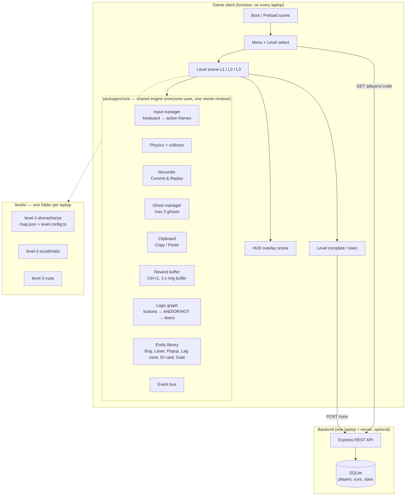

# Pixa — Architecture & Workflow

Game: a 2D pixel puzzle-platformer. Hero **Bit** solves puzzles with CS mechanics across three venues:
L1 Dronacharya Sports Ground → L2 Aryabhatta Classroom → L3 Vyas CSE Building.

Team setup: **3 laptops, one level each**, plus one shared engine everyone uses.

---

## 1. Recommended stack

| Layer | Choice | Why |
|---|---|---|
| Game engine | **Phaser 3 + TypeScript + Vite** | Runs in a browser on all 3 laptops, no installs, fast reload, built-in arcade physics |
| Level editor | **Tiled** (exports JSON) | Designers lay out tiles/objects; engine loads JSON, no hard-coded maps |
| Art | **Figma** → PNG sprite sheets (export @1x, nearest-neighbour scaling) | Figma frames map 1:1 to game assets |
| Backend (optional, for demo day) | **Node + Express + SQLite** on one laptop (or Supabase) | Player progress, stars, leaderboard shared across the 3 laptops over LAN |
| Repo | One Git repo, monorepo | Shared core + 3 level folders, each laptop owns one folder |

Base resolution **320×180**, scaled ×4 to **1280×720**. Tile size **16×16 px**. Fixed timestep **60 fps** (needed for exact ghost replay and rewind).

---

## 2. System architecture



### Folder layout

```
pixa/
├─ packages/core/          # shared engine — PRs need 1 review
│  ├─ input/  physics/  recorder/  ghosts/  clipboard/
│  ├─ rewind/ logic/      entities/ hud/     events.ts
├─ levels/
│  ├─ level-1-dronacharya/ # Laptop 1 owns
│  ├─ level-2-aryabhatta/  # Laptop 2 owns
│  └─ level-3-vyas/        # Laptop 3 owns
├─ assets/                 # Figma exports (sprites, tiles, UI)
├─ server/                 # optional Express + SQLite
└─ docs/
```

---

## 3. Core systems (shared by all levels)

### 3.1 Input
Every frame, keyboard state becomes an **ActionFrame**:
```ts
type ActionFrame = { left: boolean; right: boolean; jump: boolean; interact: boolean;
                     throw: boolean; copy: boolean; paste: boolean };
```
Default keys: `A/D` or arrows move · `Space` jump · `E` interact · `R` start/stop commit · `C` copy · `V` paste · `F` throw ID card · `Z` Ctrl+Z rewind · `Esc` pause.

### 3.2 Commit & Replay (Recorder + Ghost manager)
- `R` starts recording. Max **10 s = 600 frames**. `R` again or timeout ends it.
- Store **positions + action flags per frame** (not just inputs) so ghosts never drift.
- **Rule (important, see suggestions):** while recording, Bit is a *draft* — the draft can pass firewalls like a ghost. When the commit ends, Bit snaps back to where recording began, and the ghost starts looping.
- Max **3 ghosts**. A 4th commit removes the oldest (shown in HUD as "commit dropped").
- Ghosts are solid on top (Bit can stand on them), can press buttons, can carry crates, ignore firewalls, are blocked by walls and popups.
- Loop seam: if a ghost's first and last frames are both on the same button, the button stays pressed through the seam (no flicker).

```ts
type Commit = { id: string /* "a1f3c9" */; frames: { x:number; y:number; a:ActionFrame }[];
                createdAt: number };
```

### 3.3 Clipboard (Copy / Paste)
- `C` while touching a copyable object (crate, bench, platform, spring) copies it. `V` shows a placement preview (green = valid, red = overlap), `V` again places.
- `level.config.clipboardLimit` = how many pastes allowed. Pasted copies show a dotted outline.

### 3.4 Rewind (Ctrl+Z)
- Ring buffer of world snapshots, **180 frames (3 s)**. Snapshot = Bit, ghosts' loop index, movable objects, button/door states, bugs, popups.
- `level.config.undoLimit` uses per level. Rewind plays backwards visually (~0.5 s) then resumes.

### 3.5 Logic graph
Levels describe wiring as data; the engine evaluates it every frame and draws glowing wires.
```ts
type LogicNode =
  | { id:string; type:'button' | 'switch' }           // inputs
  | { id:string; type:'AND' | 'OR' | 'NOT'; in:string[] }
  | { id:string; type:'door' | 'laser' | 'gate'; in:string };  // outputs
```

### 3.6 Event bus (what HUD, audio, backend listen to)
`commit:start` `commit:end` `ghost:dropped` `clipboard:copy` `clipboard:paste` `undo:used`
`button:down/up` `gate:open/close` `bug:stomped` `card:thrown/returned` `popup:closed`
`player:died` `level:complete {time, undosUsed, cardThrows, ghostsUsed}`

### 3.7 Level config contract (each laptop fills this in)
```ts
export default {
  id: 'L1', name: 'Relay Race', venue: 'Dronacharya Sports Ground',
  map: 'map.json',
  mechanics: { commit: true, clipboard: false, undo: false, idCard: false },
  limits: { maxGhosts: 3, recordSeconds: 10, clipboardLimit: 0, undoLimit: 0 },
  logic: [ /* LogicNode[] */ ],
  star: { type: 'time', value: 30 },     // or 'maxCardThrows' | 'noUndo'
  next: 'L2',
};
```

---

## 4. Backend API (optional, for demo day across 3 laptops)

Players get a short **player code** (e.g. `BIT-4821`) on laptop 1 and type it on laptops 2 and 3, so stars and total time follow them.

| Method | Route | Body / result |
|---|---|---|
| POST | `/players` | `{ name }` → `{ code }` |
| GET | `/players/:code` | progress: levels done, stars, best times |
| POST | `/runs` | `{ code, levelId, timeMs, undosUsed, cardThrows, ghostsUsed, star }` |
| GET | `/leaderboard/:levelId` | top 10 by time |

Tables:
```sql
players(code TEXT PRIMARY KEY, name TEXT, created_at INT)
runs(id INTEGER PRIMARY KEY, code TEXT, level_id TEXT, time_ms INT,
     undos_used INT, card_throws INT, ghosts_used INT, star INT, created_at INT)
```
If the network fails, the client saves runs to `localStorage` and retries later, so the game never blocks on the server.

---

## 5. Team workflow

```mermaid
flowchart LR
  A[Day 1: lock this doc<br/>+ level config contract] --> B[Figma: shared design system<br/>01-design-system prompt]
  B --> C1[Laptop 1: L1 Figma + Tiled map]
  B --> C2[Laptop 2: L2 Figma + Tiled map]
  B --> C3[Laptop 3: L3 Figma + Tiled map]
  A --> D[Core engine: input, physics,<br/>recorder, logic graph first]
  C1 & C2 & C3 --> E[Export PNG sprite sheets → assets/]
  D & E --> F[Each laptop builds its level<br/>on branch level-N]
  F --> G[Playtest swap: each laptop plays<br/>another's level]
  G --> H[Merge to main → backend hookup → demo]
```



**Order of work**
1. **Everyone (2–3 h):** agree on this doc, tile size, palette, controls, `level.config` shape.
2. **Figma:** run the *shared design-system prompt* once (Bit, HUD, buttons, gates, wires). All three levels reuse it so the game looks like one game.
3. **Split:**
   - Laptop 1 → L1 + owns **Recorder/Ghosts** + **Bug** (L1 needs both first).
   - Laptop 2 → L2 + owns **Clipboard**, **ID card**, **Logic graph**.
   - Laptop 3 → L3 + owns **Firewall laser**, **Popup ads**, **Rewind**, and the **backend**.
4. **Branches:** `core/*` for engine features, `level-1`, `level-2`, `level-3` for levels. Merge to `main` daily.
5. **Asset hand-off:** Figma frame names = file names (`l1_track_tile.png`, `ui_hud_commit_slot.png`). Export @1x PNG; the engine scales up with nearest-neighbour filtering.
6. **Playtest swap:** each laptop plays another team's level with no hints. If they can't find the "aha" in ~2 minutes, add a visual hint.

**Definition of done per level:** level loads from JSON, can be finished, star condition is tracked, `level:complete` event fires with stats, art from Figma is in, no console errors.
